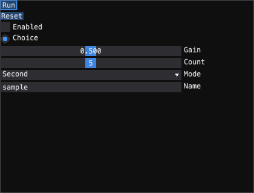
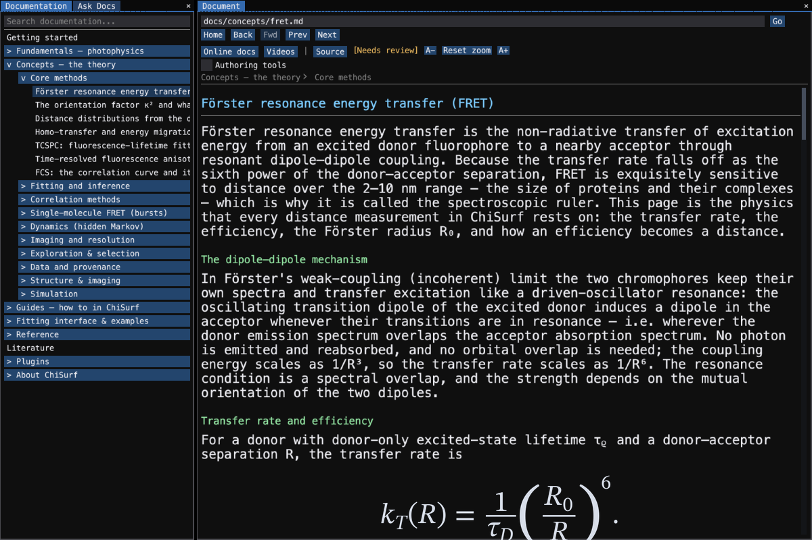

# Native UI interaction and headless checks

Native emtk forms support Tab and Shift-Tab within the current window. Enter
and Space activate a focused button or toggle. Left and Right adjust sliders;
Up and Down change a focused combo. Tab into a text field to edit its contents.
The focused control has a visible outline. Games accept Shift and keypad arrow
keys; Control, Alt and Meta remain application shortcuts.



Standalone plugin windows restore size, position and dock layout. A position
outside the primary screen is discarded. Qt hosts report moves; native GLFW
hosts restore position when supported. Offscreen hosts have no desktop position.
Viewport-derived panel regions continue following the host size.

The documentation browser inherits the application font and font size. Reset
zoom returns to that configured size. Code blocks retain their code font.



Use `emtk.testing.Driver` to drive real input into an app without opening a
window. It records screenshot font metrics, locates named controls or captions,
and delivers pointer press/release and keyboard events:

```python
from emtk.keys import KEY_TAB, KEY_RETURN
from emtk.testing import Driver

# app is an existing plugin factory result; disable persistence for test runs.
driver = Driver(app, (1100, 720))
driver.frame(2)
print(driver.ids())
driver.click("run")
driver.settle(timeout=30)
driver.press(KEY_TAB)
driver.press(KEY_RETURN)
driver.screenshot("renders/checked.png")
app.close()
```

Unknown targets raise `LookupError`; unfinished workers raise `TimeoutError`.
The driver does not close the app. Tables and node editors consume handled
wheel events once; idle redraws must leave their scroll or zoom unchanged.

Run targeted files through the project test environment:

```sh
QT_QPA_PLATFORM=offscreen CHISURF_SETTINGS_DIR=/tmp/chisurf-ui-check \
PYTHONPATH="/Users/tpeulen/dev/emtk:modules/chimol:modules/mmfdb/src:." \
pixi run -e test python -m pytest test/gui/test_autoform_state.py -q
```

Adapt the emtk checkout path to your machine. Build compiled providers with
`pixi run -e test build-extensions` first. Sibling builds use their target
prefix for both tools and HDF5 validation; they must not inherit pixi's
`CONDA_PREFIX`. For migration review, capture the old control first, keep a
before/after inventory, and inspect both PNGs. Tests that only construct a
widget cannot establish layout or control parity.

A recorded target without a rectangle is currently unavailable, for example an
image canvas before data loads. Driver excludes it from `ids()` and raises
`LookupError` rather than inventing a click location. Composite hosts forward
optional key-release hooks only when a child implements them. Form callbacks
receive the committed field value.


## Help on host headers

Shared imaging panels, AI Settings and Photon Table expose their existing panel
explanations when you hover the dock tab or floating window title. The explanation
uses the active language and normal tooltip delay. Close and collapse buttons
keep their own help. Panels without a description add no extra control or row.

When a host draws only a panel's children, or suppresses form titles, it must
pass the panel description to the dock window's `tooltip` field. A description
in the spec alone does not prove it is reachable. Use real delayed hover and
paint checks for docked and floating states, then compare unhovered controls and
geometry at default and narrow sizes. Specific field/table help retains priority.

## Isolated plugin interaction gate

`test/e2e/test_click_all_plugins.py` discovers native entrypoints and the
remaining Qt-only factories. Each plugin runs in its own process with scratch
settings, metadata, object storage and cache. Worker JSON/log/PNG artifacts
live in `renders/e2e`; their harness_sha256 must match the tested source.
Timeouts, native crashes, missing tours/tooltips and unreachable controls are
explicit failures. A failed factory cannot retain an older PNG as evidence.

Native clicks require a visible effective clip and real engine delivery to
the intended context. The recorder maps translated/scaled child painters to
global coordinates, distinguishes independent engines with identical IDs,
opens actual AutoForm folds and scrolls reachable controls. Tour checks walk
introductions and operate the first real awaited target; duplicate labels
resolve through authoritative geometry/context, and ambiguity fails.
Field text retained for interaction is private to the worker, not serialized.
OS dialogs cancel; service/network and external-process actions remain
guarded. Slow local computations must expose a working Cancel/Stop control.

Re-derive the harness regressions with
`pixi run -e test python -m pytest test/e2e/test_click_all_harness.py -q`
(36 passed), and select real plugin cases with `-k <plugin_id>` on the click-all
file. A complete plugin matrix remains a programme gate after the owning
workstreams supply tours, demos, reachable layouts and source prerequisites.
The C27 matrix and intermediate hash runs are diagnostic, not acceptance.


## Reader settings at the existing shell seam

`ReaderSettingsApp` renders a reader's declared native JSON or typed ModelView
through the existing section registry. The actual reader remains its model,
so values and callbacks update the scientific owner. The settings dock uses
ControlHost for a reader without a legacy controller and reuses its live host.
The declaration is validated before installation; unsupported legacy customs,
plots or session curve actions are reported rather than omitted.

Native file/folder and MMFDB data-source inputs retain typed values, Browse,
Database, callbacks, read-only state, cancellation and drops. Session curves
are distinct from database file paths; the old curve_input index/name/action
contract requires its own group-member/API selector integration. Closing a
view prevents delayed database delivery from changing the reader.

Verify the prerequisite with the two targeted reader_settings host test files
(20 passes). The captured CSV supported subset is a host proof, not the complete
CSV migration; its format/error/custom controls remain in the legacy controller
until the full reader declaration is ported.


## Retired unused photon sample widget

The uncalled SpcFileWidget and its dedicated Designer file are removed.
Photon reading, CSV inputs and native reader settings retain their existing
interfaces. A real BH SPC132 baseline and control inventory are retained in
the release-readiness evidence; this approved dead-widget deletion introduces
no replacement window.


## Measured SDT reader declaration

SDTReader now declares its SDT-only source, decoded file information, measured
channel width/repetition rate and preview curve. Preview selection never
filters imported curves: the shell import route reads all blocks, using each
block's own time axis and excitation descriptor. The fixture's600 ns period
yields1000/600 MHz in float64; its channel width is0.019537081674680934 ns.
The native view preparation retains source/information/rate/curve controls.
The old embedded Add was unconnected; the functional shell import remains.
The legacy controller stays configured until the preceding CSV port lands.


## Single-file structure reader declaration

The prepared StructureReader form binds one PDB source, internal-coordinate
computation and read-only atom/residue counts to the original reader. Counts
appear after a successful import and clear when the selected source changes.
An explicit read(filename=...) overrides the selected source. The inspected
148L scene has1300 atoms and164 residues. The uncalled, nonfunctional folder
wrapper is a separate retirement; the scientific reader imports one file.
Legacy loader/configuration removal follows the CSV/SDT/simulator ports.

SDT source configuration is explicit in its constructor and stays lazy; it
works with the committed base reader independently of the pending CSV port.
A missing source can be restored and is opened only for preview/import.


## Session curves retain group-member identity

Session curve inputs use ChiSurfAPI, separately from file/MMFDB materialization.
Dataset summaries retain the outer index and list direct members, including
one-member groups. Keep the parent UID and selected member UID together.
get_dataset_info/get_dataset_curve_data accept member_uid; an unknown supplied
UID fails without index/name fallback and never changes the active group member.
IRF/model dataset actions forward these identities while retaining fit_index
and action_fixed slots; a copied IRF retains the selected name.
The native Simulator picker integration follows this API prerequisite.


## Complete native CSV settings

CSV input/timing/anisotropy controls are now declared over the scientific
reader. Native source selection delivers the original reader to the shell
import action exactly once; supplied columns/errors/delimiters and FWF layouts
reach their owning parser. Source/error/link selections survive reader-state
roundtrips. The native G-factor child applies completed finite calibration on
close and cannot update a closed reader view. See the TCSPC file-format
reference for the user workflow and actual loaded-reader screenshot.


## Declared tabs and pending edits

Native tabs now expose scoped header targets such as simulator.decay and
simulator.preview, submit only the selected page and preserve values across
reopen/translation. Switching pages commits pending ordinary values using
the existing parsing/bounds/callback rules before the next page reads them.
Custom controls with their own nested FormState own those pending edits;
the simulator explicitly flushes its auxiliary spectrum input lifecycle.


## Simulator declaration and app-owned context

SimulatorSettingsApp binds the original scientific reader through a frontend
adapter; no numerical generator/read body is changed. Real tabs retain decay
settings/IRF, anisotropy and computed preview. Noise/seed stay explicit and
view construction preserves supplied spectra and parameters. Add retains the
computed preview group; its remote/import acceptance is a separate gate.
Main now owns one cached PluginContext, retaining injected API/state/client
identities or composing from its existing transport/embedded state/live list
aliases without starting a service or connecting a new client.
Data sources declare primary:false for auxiliary settings files. Main
imports generators with filenameNone before considering inherited filename;
only measurement inputs can launch the import picker. The simulator commits
its nested spectrum-path buffer on tab use through the original setter;
invalid input retains science/pending/error state and close/read-only guards.


## Cached curve groups across the API

Add sends the displayed curve group through dataset.load without regenerating
its simulation. The existing payload accepts a validated group envelope with
all member arrays/errors/masks, group/member identities, selected index and
scientific metadata. Trusted reader calibration and its measured IRF survive
JSON transfer. Validation finishes before any session append. Explicit local
API state remains authoritative; the live aliased state keeps its macro/history
route. Local cached Structure groups stay unchanged; remote noncurve data
requires its owning importer and is never silently flattened. Boolean masks
roundtrip through transport/project capture/restore; measurement/error arrays
retain the finite numeric-vector contract.


## Installed runtime resources

Source-only plugin tests and fixtures are excluded from runtime wheel/sdist
resources. Reader JSON, settings and rendering shaders remain installed.
The molecular viewer resolves its bundled 148L/topology/trajectory demos via
its own resource catalogue, retaining explicit user data directories.


## Canonical structural provider build

The extension build includes imp-tricks through its declared no-deps editable
task. Cold isolated imports and clean wheel tests verify cgmol kernels and
statistical-potential data. Source-tree wheels can reuse stale generated
metadata; always use a clean source copy for runtime resource coverage.
The Model-free BFF core remains the pinned provider; RMF output requires its
explicit molecular-output/backend contract and cannot be replaced by a
mislabeled coordinate-only file.


## Configured Structure port

The shipped Structure setup now has no legacy controller; its native form
imports the selected PDB once through the existing shell action. Source-free
restoration derives reader display facts from embedded atoms only for matching
sources. Folder helper/thread exports and their UI files are retired while
PDBSelector remains unchanged for the next FRET host migration.


## Unreachable loader retirement

The manually instantiated AVProperties and TTTR file-format wizard are retired
with their dedicated designer files and exports. They had no application callers
or registry records. Fresh-interpreter guards verify the exact owning Dye,
ProteinQuenching and Sticking bindings and retained wizard neighbors. No
application control was replaced; the measured AV1/AV3/SPC baselines remain
in the source-hygiene record. Do not use the no-op basic test as import proof.


## Dense marker and table access regressions

Marker primitives preserve alpha, transforms, clipping and DPI while Qt replays
bounded cached triangle glyphs and software checks exact opaque coverage.
The full measured183657-photon fixture retains original arrays and selection;
its existing positive delta-time mask plots183648 points. Explicit zero marker
weight removes only the outline and keeps automatic fill/visible legends.
Stable column-visibility calls preserve horizontal scroll/selection/revision;
actual visibility transitions still reset and notify once. Test real offscreen
action access after scrolling, rather than assuming a horizontal bar proves it.


## Native Help verification

Help windows retain the complete document and live links. Header actions and
category filters wrap to the available width; the document scrolls inside its
body while Close remains visible. Dragging the dialog preserves the current
reading position. Check the last category and the last live link at narrow
window sizes and at2×device scale, not only the first screen.

Compare the actual Qt render with software captures when text appears outside
a child clip: texture/font diagnostic clipping can differ from application
layout. The installed toolkit applies nested scissoring to both textures and
real-font glyphs. Regression examples are
`test/gui/test_native_help_scrolling.py` and
`test/gui/test_help_window_markdown.py`.
