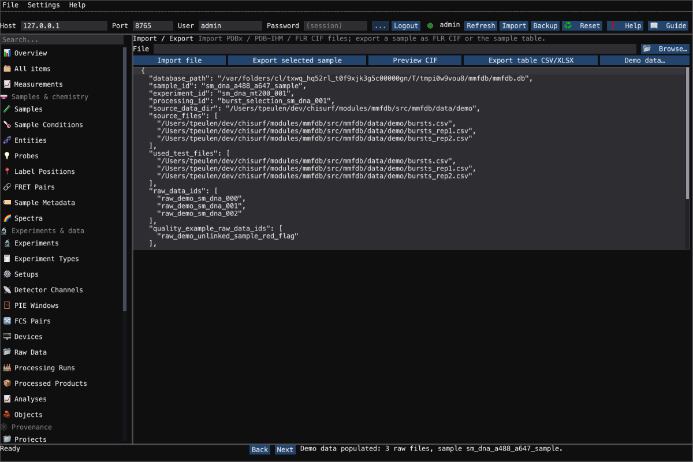

# Administering the measurement database: MMFDB Admin

The Multiparametric Fluorescence Database (MMFDB) keeps the records ChiSurf
writes about samples, experiments, setups, raw data, processing runs, products and
analyses. It also keeps the provenance that links them: which operation turned which
artifact into which. What it stores and why it is kept as a graph is explained in
{doc}`The measurement database </concepts/measurement_database>`. This guide
covers the administration tool.

Open **Tools → System → MMFDB Admin**, or run it on its own with `python -m chisurf.emtk --plugin mmfdb_admin`. The window is
drawn natively (emtk). The older Qt widget is kept for now as the legacy
`entrypoints.gui`.

For headless fluorophore curation, the same plugin declares the owning MMFDB
Click command under `csc fluorophore`. Its commands operate on the configured
local MMFDB, independently of the GUI server connection:

```bash
pixi run -e test csc fluorophore --help
pixi run -e test csc fluorophore list --json
```

Use `--help` on a subcommand for its options.

```{figure} figures/102_mmfdb_admin.png
:name: fig-mmfdb-admin
:width: 100%

MMFDB Admin on a seeded database: the rail on the left, the Samples table, and
the selected sample's dictionary-driven form below it.
```

## 1. Sign in

The toolbar names the server: **Host** and **Port** for the embedded server, or a
base URL for a standalone one. It also takes the **User** and a **Password**.
**Login** connects. A session this ChiSurf process already holds is reused, and an
account allowed to sign in without a password does not need one. In every other
case the login dialog asks for the password. **...** opens that dialog directly,
and its *Advanced* fold switches user, host and ports. The dot next to the
toolbar is green when connected, yellow while connecting and red when not
connected.

Only administrators can use MMFDB Admin. Any other account is signed in and then
refused: the panels stay empty and the status bar says why. A fresh database with
no administrator yet can be administered by anyone. The tool never stores a
password. Its saved settings are the open panel, the panel splits, the host, the
port and the user.

## 2. Find a panel

The rail groups the panels the way the database is organised: *Samples &
chemistry*, *Experiments & data*, *Provenance*, *Administration* and *Workflows &
QC*. Type in **Search...** to narrow it. **Back** / **Next** in the status bar
step through the rail. A panel loads the first time it is opened, and
**Refresh** reloads it.

## 3. Read and edit records

Most panels show one table of the database. Click a row to open it in the form
below. Click a header to sort, type in the filter box to keep the matching rows,
and drag the bar to share space between the table and the form. The form fields
are generated from the mmCIF dictionaries (FLR / PDBx), so a field's tooltip is
its dictionary definition.

**A field is saved when you commit it**: press Enter or click elsewhere. There
is no Save button. **New** creates a record at once and opens it. **Delete**
deletes the *ticked* rows after asking. An underlined cell names another record:
double-click it to open that record in its own panel.

Some panels have their own actions. Users have **Change password** and **Jump to
branch**. Branches have **Set head**. Raw Data and Processed Products have
**Copy ID**, **Reveal**, **Use as provenance seed**, **Validate** and **Delete**.
Experiments show their linked data in a sub-table (**Add data**, **Save data**,
**Delete data**, **Open data**); Setups have **Validate setup**; Projects list their
archived versions with **Restore project to ChiSurf** and **Delete archived version**
(only the picked one, after asking). Right-click a row (or press Shift+F10) for **Copy row**, **Copy selected cell**,
**Copy checked IDs**, **Select all rows** and the tick helpers (**Check all**, **Uncheck all**, **Invert checks**).
Analyses have **Details**, and Objects have **Copy UUID**, **Reveal** and
**Delete object**.

## 4. Trace a product back to its raw data

On a Processed Products (or Raw Data, or Analyses) row, press **Use as
provenance seed**. The **Provenance Graph** panel opens with that record's
upstream graph loaded. You can also type a seed into **Seed Type** / **Seed ID**
and press **Load upstream**, **Load downstream** or **Load full graph**. Each
node is an artifact (blue) or an operation (orange). Click a node to read its
record on the right. **Export JSON** / **Export ZIP** write the graph or a full
archive.

## 5. Curate spectra

**Spectra** lists fluorophores, filters, dichroics, detectors and light sources.
Pick a row to plot its spectra, or tick several to overlay them. **Approve** /
**Reject** set the verification status, and **Review queue** keeps the
unverified entries. **AI triage** runs deterministic plausibility checks.
**Find Duplicates** groups near-duplicate probes, so you can compare their
spectra and merge each group into a primary.

## 6. Import, export, back up

**Import / Export** imports a PDBx / PDB-IHM / FLR CIF file. It also exports the
sample selected in *Samples* as FLR CIF (validated first, with a preview) and
exports the sample table as CSV / XLSX. **Backup** writes a copy of the active
database. **Reset** first asks, then writes a backup, and finally replaces the
user database with the curated source.

## Headless and Python

Every action of the tool is an MMFDB RPC method that the server runs. The same
calls are available without a window through the client:

```python
from chisurf.plugins.core.mmfdb_admin.gui.client import MMFDBClient

client = MMFDBClient(mode="embedded")
client.login(user_id="admin", password="...")
samples = client.list_samples()
graph = client._call("provenance.dependencies.upstream",
                     {"node_type": "processed_data", "node_id": "prod_gui"})
```

The view model behind the window, `gui/native/model.py::AdminModel`, is Qt-free.
The plugin's tests drive it against a seeded temporary database
(`test/seeded_admin.py`).

## See also

- {doc}`The measurement database </concepts/measurement_database>` covers what is
  stored, the provenance graph, and the access rules.
- {doc}`Inspecting a container </guides/63_pto_inspector>` covers provenance
  inside a single `.pto` file.


## Legacy administrative metadata example

The legacy Qt administrator retains a sample-population action after ten
left clicks on its header label. Its confirmation and running state now name
the packaged synthetic smFRET burst tables. Declining starts no population.
The authenticated backend uses120 source rows from three packaged CSVs and
stores the real63-row selection with hashes and lineage. These are metadata
examples; the action does not acquire photons or require checkout test files.



The native administrator currently has no matching population control.
For a headless administrative example, use the owning MMFDB `seed_example`
API with an explicitly selected demo database; its sources and produced table
are managed objects in that database's object store.

Tool: MMFDB Admin (`chisurf/plugins/core/mmfdb_admin/`).
