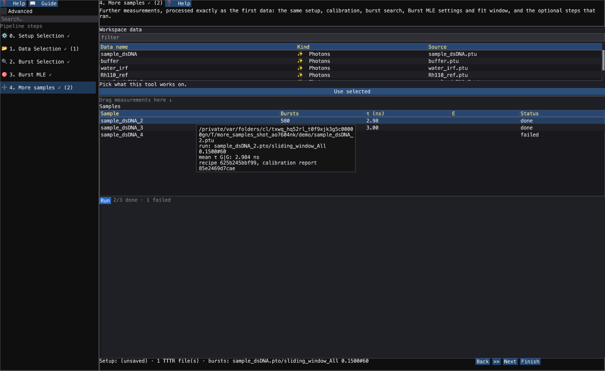
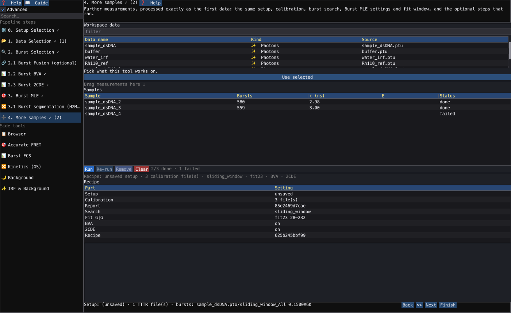

# More samples, processed the same way

**Spectroscopy › Single-Molecule › Burst Analysis**, step **4. More samples**
(`chisurf/plugins/burst/burst_analysis/more_samples.py`, window
`gui/more_samples_app.py`). The pipeline steps are in [Lifetime from photon
bursts](21_lifetime_from_bursts.md) and [Photon burst identification](13_burst_identification.md).

A measurement series — the same construct at several conditions, repeats of one sample, a
titration — is only comparable if every measurement went through the **same** analysis. You tune
the pipeline on one measurement, then hand it the rest: step 4 runs each of them through exactly
that pipeline, one short row per sample.

## The recipe

What every sample goes through is one **recipe**, captured from the steps as they are set when
you press **Run** (`Recipe.capture`, from what the steps already export — the workflow context,
Burst Selection's settings, Burst MLE's settings payload):

| Part | From | Applied to each sample |
|---|---|---|
| Setup | step 0 | the same detectors, windows and G factors |
| Calibration | step 1 | the same buffer, IRF and reference-dye files, the calibration report |
| Burst search | step 2 | the same algorithm, parameters and filter |
| Burst MLE | step 3 | per detector the same model, start values, fixed parameters, **fit window**, IRF and calibrated time shifts |
| Optional steps | 2.1–3.1 | Fusion, BVA, 2CDE, H2MM — each only if it ran on the first data |

The **background** is the rule, not the number: the buffer's when step 1 has a buffer, else the
strict background selection of each sample's **own** photons (background belongs to the
measurement). New calibration files are added in step 1; the recipe follows them.

## In the window

1. Run steps 0–3 on the first measurement. Step 4 opens once Burst MLE has fitted it.
2. Drop further measurements on step 4: drag them from its *Workspace data* table into
   *Samples* (a group brings all its files), or drop files on the ChiSurf window while the step
   is open.
3. Press **Run** (or **Next**). The window waits behind the progress card; **Stop** stops after
   the step each sample is in (every sample in flight).



Each row is short — sample, bursts, mean τ of the first detector, mean E (two colours), status
(*queued*, *running*, *done*, *failed*). The tooltip has the rest: the run, τ per detector, the
recipe and calibration-report ids, or why the sample failed. A failed sample never stops the
others; **Run** again processes the failed and queued ones.

**Advanced** adds the recipe, one short row per part with its details in the tooltip, and
**Re-run** of the selected sample with the recipe as it is now:



## Using the whole machine

A batch is scheduled, not looped (`more_samples.SampleQueue`):

- **One pool, all stages.** A single pool of `core_budget()` worker processes — the physical
  cores but one (the window's), never more than Burst MLE's own fit limit, because it *is* Burst
  MLE's fit pool — runs every sample's burst search, BVA and 2CDE and takes every sample's fit
  chunks. No pool is started per sample or per stage, so the batch never runs more workers than
  that, and the stages of different samples overlap: sample 2 searches while sample 1 fits.
- **Samples in flight.** As many as there are worker processes and free memory for, admitted
  largest first while the memory of those in flight leaves room (`concurrent_samples`). One sample
  needs about 37 bytes per byte of its photon file — 20 M photons (a 103 MB PTU) about 3.7 GB,
  measured as the physical footprint of the window's process and the pool; the batch plans with
  60 % of the memory that is free, and always runs at least one.
- **Rebalancing.** While every worker has a sample, everything after a sample's search is one task
  of the pool (its fit runs in that worker); once fewer samples are in flight, the stages run in
  the window's process again and the fit's chunks fan out over all the workers, so the last
  samples get the freed cores.

Measured on an 8-core laptop (7 workers, 16 GB, about 3 GB free; other jobs kept its load average
at 20–30, so these are lower bounds), the benchmark is described in
`okf/plugins/burst.md`:

| Batch | One after the other | Side by side | Speed-up |
|---|---|---|---|
| 6 demo samples (~0.6 MB, ~570 bursts each) | 6.5 s | 2.5 s (6 in flight) | 2.6× |
| 6 synthetic samples (2 M photons, 5.5 k bursts each) | 22.4 s | 13.6 s (3 in flight: memory) | 1.6× |

The results do not depend on any of this: a batch run side by side gives the same bursts and
lifetimes as one run sample after sample (tested). `process_more(..., workers=1)` keeps one sample
in flight.

## Where the results go

Where the first data's went: each sample's burst run into its `.pto` analysis container (shown
under its photon stream in the workspace), its Burst MLE lifetimes and its BVA / 2CDE / H2MM
results as tables of that run, and beside them the calibration report (`burst_calibration`) and
the recipe (`burst_recipe`, with `recipe_id` and `calibration_report_id`), so every number names
what made it (`more_samples.read_recipe(container)`).

## Headless

```python
import json

from chisurf.plugins.burst.burst_analysis.api import BurstWorkflow, Recipe

if __name__ == "__main__":          # the burst fit runs in worker processes
    recipe = Recipe.from_payload(json.load(open("recipe.json")))
    rows = BurstWorkflow.offline().process_more(["m2.ptu", "m3.ptu"], recipe)
    for row in rows:
        print(row["name"], row["status"], row["bursts"], row["tau"], row["error"])
```

The recipe is what the window keeps in its settings (`state["children"]["more"]["recipe"]`) and
what `hub.capture_recipe().to_payload()` returns; save it as JSON once and every later batch uses
it. Processing a measurement with `process_more` and running steps 2–3 on it by hand with the
same settings give the same bursts and the same lifetimes (tested,
`burst_analysis/tests/test_more_samples.py`).

Figures: `docs/guides/screenshots/guide_116_more_samples.py`.
