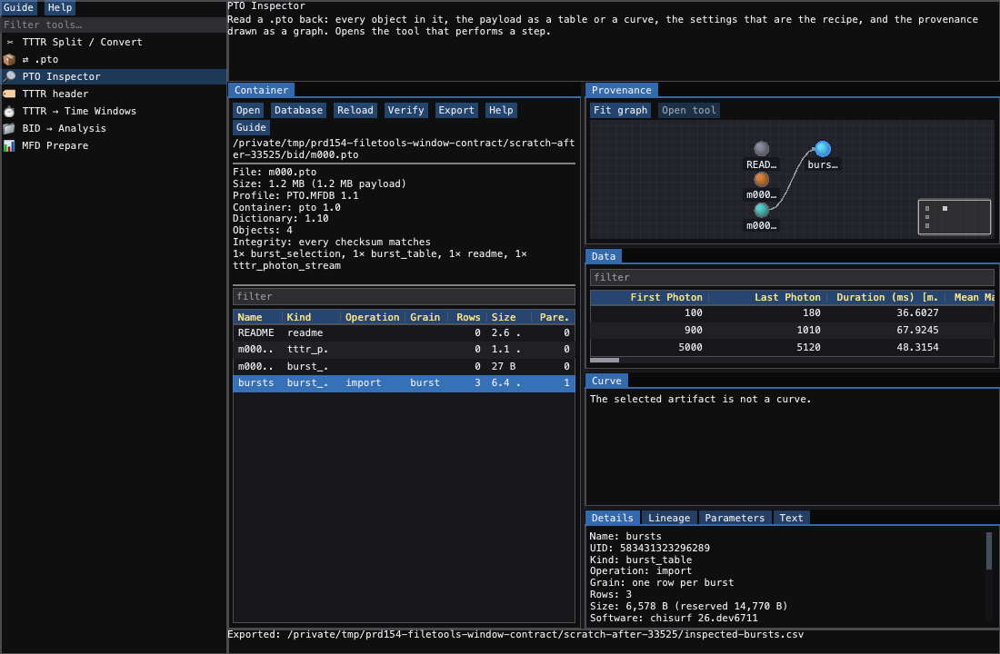
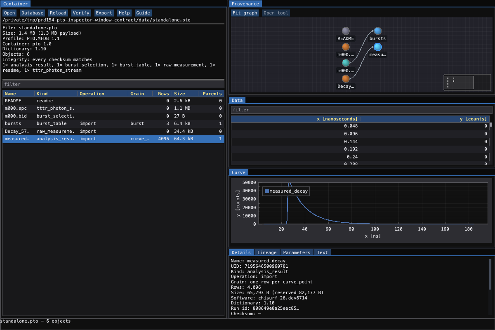

# Inspecting a container: what is in a `.pto`, and how it got there

A `.pto` holds one measurement: the instrument file byte-for-byte, and every
result computed from it beside it, each recording the operation and the complete
settings that produced it (see
{doc}`The photon container </concepts/photon_container>`).

All of that is recorded whether or not anyone reads it. This guide is about
reading it.

Open **File → Data → File tools → PTO Inspector**, or drop a `.pto` on the window.
Nothing here writes to the file.

## What is in it

The **Objects** list on the left is one row per object, in the order it was
written. The columns are the container's own vocabulary rather than the tool's:

| column | what it is |
|---|---|
| Kind | an `_mmfdb_artifact.artifact_kind` term — what sort of thing this is |
| Operation | the `_mmfdb_operation.operation_type` that produced it; empty means it was *carried*, not computed (the instrument file, the README, the sample metadata) |
| Grain | what one row **is** |
| Rows / Size | the payload |
| ← | how many objects it was derived from |

**Grain** is the load-bearing one. Nothing in a container is joined by position:
a dwell table is finer than the bursts it came from and a fused-burst table is
coarser, and a format that could only carry one row per burst would have nowhere
to put either. Where two tables relate, the relation is a **declared key** — the
details panel shows it as `on First Photon = First Photon` — not an alignment of
row counts.

## How it got there

The **Provenance** tab draws the derivation graph: the instrument file on the
left, the last thing computed on the right, one arrow per **recorded**
derivation.

Each artifact is a circle coloured by its kind, with its name beneath it.

Look for a node with two incoming arrows. A burst-wise lifetime fit is derived
from the bursts *and* from the background, and that is the case an indented tree
cannot draw — it must either repeat a node or drop an edge. The colours group the
kinds: photons brown, tables blue, analysis results green, curves violet, models
and residuals red.

Click a node and every other panel follows it. Double-click one to open the tool
that performs its step.

```{figure} figures/pto_inspector.png
:name: fig-pto-inspector
:width: 100%

One container, every panel at once. **Provenance** (top right) draws the two
recorded steps: the instrument file (brown) → the burst table (blue) → the decay
computed from those bursts (violet); the README sits unconnected because nothing
was derived from it. The object list (left) is the same four objects as rows,
with the kind, the operation that made each, the row grain and the size.
**Data**, **Curve** and **Details** below all follow the selected node — here the
decay, its 256 × 2 payload, the curve itself, and the operation and version that
produced it.
```

## The numbers

**Data** shows a tabular payload in the shared table — search, filter, hide
columns, sort, export. The headers carry the unit the **column itself** states
(`tau_green [ns]`, `Duration [ms]`), because a number whose unit lives only in a
naming convention is a number that eventually gets read wrong.

**Curve** draws a curve payload — a decay, a correlation, an anisotropy, an IRF,
a model, a residual. Its axis units *and its scale* come from the stored columns:
an FCS lag axis is milliseconds over six decades and gets a log axis; a decay
axis is nanoseconds and does not. The same panel shows both, so neither can be
stated in advance.

## The settings are the recipe

**Details** lists everything recorded, and the settings block is the part worth
reading. Those settings are not a label on the run — their hash **is** the
identity of the run. Recompute with the same settings and the artifact is
rewritten in place; change one and you get a new artifact beside the old. That is
why nothing accumulates in a container, and why no parameter ever has to be
encoded in a folder name.

Below it, **Lineage** is the whole path back to the primary data, with every
operation and every setting in between:

```
burst_lifetimes [analysis_result, one row per burst]
    by burst_lifetime_fitting (chisurf 26.dev5027)
      irf_shift_ns = 0.12
      model = '1-exponential'
      n_photon_min = 50
    derived_from bursts, background on First Photon = First Photon
bursts [burst_table, one row per burst]
    by burst_selection (chisurf 26.dev5027)
      M = 10
      T_us = 500
      min_photons = 60
    derived_from dsDNA_Cy3B_Cy5.ptu
dsDNA_Cy3B_Cy5.ptu [tttr_photon_stream]
```

## Opening the tool that made a result

Select a result and press **▶ Open tool** (or double-click its node). The
matching tool opens on the same file.

The lookup is worth understanding, because it is what makes a container both
portable and useful. A `.pto` records the *operation* and never the *program* —
a term naming a ChiSurf plugin would make the file unreadable by anything else,
which is the point of taking every name from the mmCIF dictionaries. So the index
runs the other way: each tool declares in its `manifest.json` which operations it
performs.

```json
{
  "id": "burst_mle_analysis",
  "entrypoints": {"emtk": "chisurf.plugins.burst.burst_mle_analysis.gui.native:create_app"},
  "operation_types": ["burst_lifetime_fitting", "calibration"]
}
```

A step no installed tool claims says so plainly instead of doing nothing — a
container may well carry a result another program computed, and the settings in
the details panel are still the whole recipe.

## Verifying

**🔍 Verify** re-hashes every payload and compares it against the checksum
recorded beside it. Do this before deleting an original file: *restorable*
without verification is only *probably restorable*.

## Export legacy

**📤 Export legacy…** is the one way to get the old folder layout out of a container:
choose a folder and it receives `bi4_bur/<stem>.bur` for every burst run, beside one
`<ending>4/<stem>.<ending>` companion per analysis (`bv4`, `2c4`, `bg4`/`br4`/`by4`,
`bh4`, `td4`, `bf4`). Every companion has one row per burst of the measurement; a
burst the analysis skipped is a row of zeros, never a missing row, and a result that
cannot be placed on the burst grid is refused. See [exporting burst
data](34_exporting_burst_data.md).

## Headless

Everything above is also available without a window:

```bash
csc csg_pto_inspect list     measurement.pto          # every object
csc csg_pto_inspect show     measurement.pto bursts   # one, with its settings
csc csg_pto_inspect lineage  measurement.pto burst_lifetimes
csc csg_pto_inspect graph    measurement.pto --out provenance.json
csc csg_pto_inspect verify   measurement.pto
csc csg_pto_inspect export   measurement.pto bursts bursts.csv
csc csg_pto_inspect export-legacy measurement.pto legacy_folder   # bi4_bur + the ...4 companions
```

and from Python:

```python
from chisurf.plugins.core.pto_inspector.core import PtoInspection

with PtoInspection("measurement.pto") as m:
    for item in m.infos():
        print(item.name, item.kind, item.operation, item.grain, item.rows)

    store = m.store("bursts")            # the payload, as a columnar store
    curve = m.curve("decay_green")       # x, y and the axis units
    steps = m.lineage("burst_lifetimes") # back to the photons
    assert m.verify() == []              # every checksum matches
```

## See also

- {doc}`The photon container </concepts/photon_container>` — what a `.pto` is
  and why the relationships are stated rather than implied.
- {doc}`Handling TTTR files </guides/12_handling_tttr_files>` — getting a
  measurement into one.
- {doc}`Reusing results </guides/53_reusing_results>` — the settings hash seen
  from the writing side.

### Wide data tables

A result with many columns retains readable headers and cells. The data table
scrolls horizontally to reach the rest of the schema; narrowing the host does
not discard columns or alter exported rows. The table, export and provenance
remain views of the same stored artifact.



### Native viewer dimensions and restored state

PTO Inspector reads its 1200 × 800 initial host dimensions from the primary
view specification. Saved user dimensions, selected artifact, filters and graph
preferences take precedence. Changing the host size preserves the container,
artifact data, curve coordinates, exported CSV and provenance relationships.
The data table retains readable column widths and horizontal navigation.


