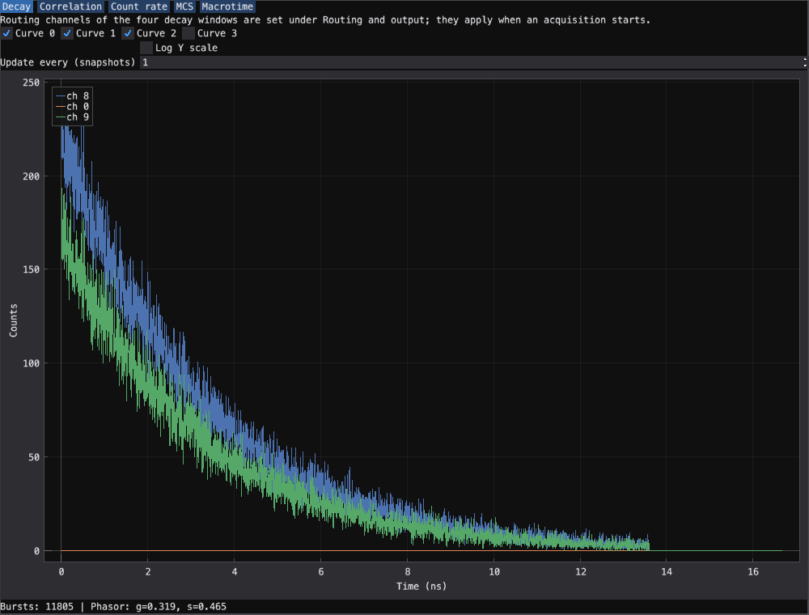
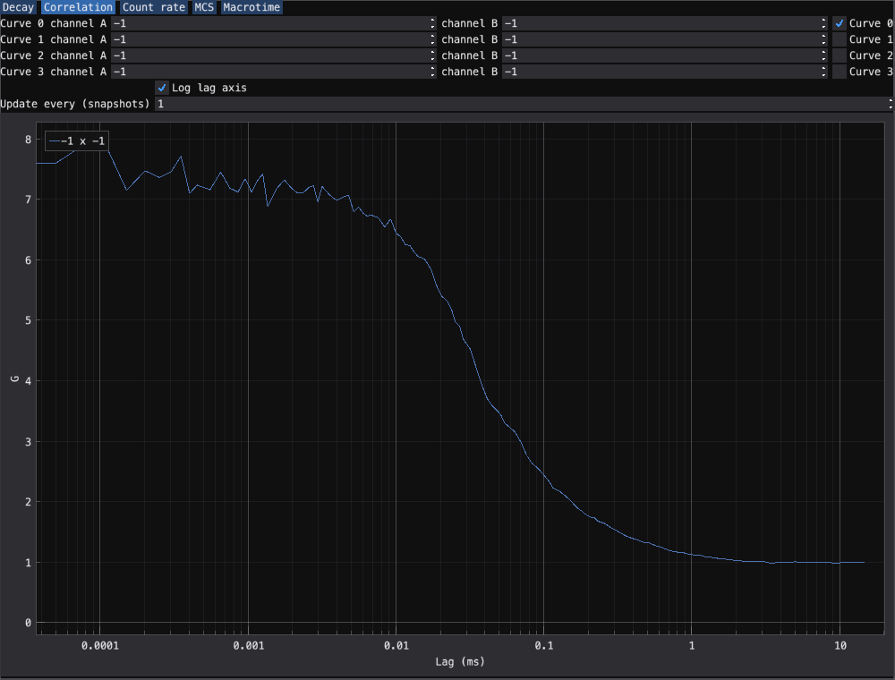
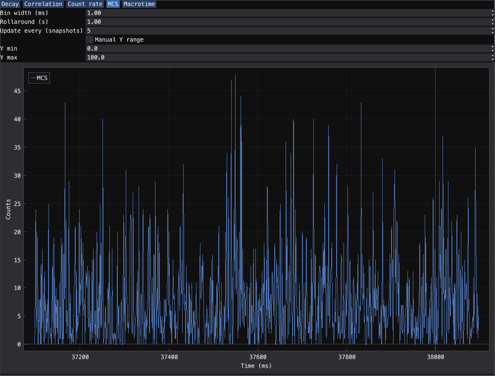

# Live acquisition: watching a measurement while it happens

**Tools → Views → Acquisition** opens the **Record** tool. `python -m chisurf --app acq`
starts ChiSurf in Acquisition mode: the tool is the only thing in the window, as on an
instrument PC, with ChiSurf running underneath. It streams photons
from TCSPC hardware, from the built-in photon simulator or from a replayed
photon stream, and analyses them *while they arrive*: bursts, the histograms of
the measurement type (E–S for PIE), a decay per detector, an FCS correlation,
count rates, an MCS trace and inter-photon times, all updated per chunk. Nothing
here re-reads the photons it has already seen, so the display costs the same at
minute 30 as at minute 1 (see
{doc}`Streaming analysis </concepts/live_streaming_analysis>`).

You do not need hardware to follow this guide: the **simulator** is a full
confocal photon simulator — diffusion through a focus, FRET states, anisotropy,
photophysics — and its records take the same path a device's do.

## Devices: phacq

Hardware is driven through **phacq**, a separate C++/Python acquisition library
with native drivers — no vendor libraries — for PicoQuant MultiHarp, PicoHarp
330 and HydraHarp 500, Becker & Hickl SPC cards, and the PicoQuant Sepia II
laser. The vendor-library device session of earlier versions (B&H SPCM-DLL,
PicoQuant and BrickMic wrappers with their *Device Setup* cards) has been
removed; there is one acquisition window, Record.

**On Windows**, PicoQuant's own driver holds PicoQuant units, so phacq reaches
them through PicoQuant's snAPI package (`pip install snAPI`) instead of its
native driver. The device, its settings and the recordings are the same; only
the way in differs. Linux and macOS stay native. The Sepia II needs no such
detour: on Windows phacq opens it through its own WinUSB binding.

**Every setting a device has is offered.** The driver describes its settings
itself — names, units, ranges, choices, which are per input — and Record builds
the device's panel from that description, so nothing is left out and a setting
a newer phacq adds appears without a ChiSurf change. The thresholds, shifts,
timing and markers are behind **Advanced** (off by default): a loaded settings
file or profile sets them, and they stay as calibrated. Connect a device under
**Acquisition → TCSPC device** and tick **Advanced** to see them: its settings start folded by group — the sync,
each input on its own fold, timing, markers and outputs (for a B&H card its CFD, sync, TAC, timers and FIFO mode).
An edit is sent at once, between runs; a value the device refuses is named in
the status line and nothing of that edit is applied. The values are saved in
the acquisition settings file (``device.settings``, phacq's names).

```{figure} figures/65_record_device.png
:name: fig-65-record-device
:width: 60%

A MultiHarp 150 8N in Record's TCSPC device panel: its settings start folded
by group — sync, timing, markers, outputs, then one fold per input.
```

**The laser.** Under **Laser**, a Sepia II shows its own switches, which act at
once: the **Soft lock** (on: every output off) and, per laser head, **Pulsed**
(off: continuous wave), the **Repetition rate** (the head's own oscillator, 80
MHz / 2ⁿ, or an external trigger edge) and the **Intensity**. Connecting locks
the outputs; **Laser off** always works. An oscillator module (SOM 828
sequencer) is not driven by phacq yet.

```{figure} figures/65_record_laser.png
:name: fig-65-record-laser
:width: 60%

A Sepia II in Record's Laser panel (phacq's simulated unit): soft lock, and the
first laser head's pulsed switch, repetition rate and intensity.
```

## Profiles

The **Settings** list starts with ready-made profiles, marked ★, before the
workspace's own settings files. Each is an ordinary acquisition settings file in
`chisurf/plugins/core/acq/profiles/`.

The MT200 profiles were made from SymPhoTime's own profiles on that microscope
(`Standard.pus`, `PIE.pus`, `CY_PIE.pus`):
* **Standard:** red laser, 40 MHz.
* **PIE:** blue and red laser.
* **CY PIE:** PIE with the red laser delayed 4 ns.

They share one TCSPC setting:
* 32 ps bins;
* sync CFD 350 mV, sync offset 5000 ps;
* detectors on HydraHarp inputs 1 and 3, 250 mV, with their offsets (+130 ps and −40 ps).

They differ only in the lasers. None sets a run length: runs are open-ended until
you press **Stop**. They don't set the Sepia's oscillator
programme yet, because phacq does not drive the SOM 828-D yet. Choose one and press
**Load**.

**Loading connects the hardware.** A settings file says which unit it is for
(`device.driver`, `device.model`, `device.serial` — the MT200 profiles name
HydraHarp 400 1032692). Choosing a file or profile in the list loads it at
once — **Load** does it again — and a progress bar says what is under way
(finding and connecting the unit, the laser, applying the settings): it connects
that unit if it is attached, and the laser the file names, then applies
everything. The settings last loaded are loaded again when Record opens with a
TCSPC device as its source. A unit that is not attached is
named in the notes and nothing else is connected in its place; a file for the
Sepia II never connects the simulated laser instead.

**No sync, still recorded.** A T3 run without a sync signal (laser off, cable
out) is recorded anyway and the device is shown as *(no sync)*: the unit still
time-tags its inputs, the macro step is provisionally the unit's start-stop
range, and the file's header takes the sync rate measured when it closes.

## Running one

Its windows (Acquisition, Laser, Analysis, Quality, the plots), sources, laser
program, settings files and measurement types are described in the tool's own
**Help** and walked through by its **Guide**. In short:

1. Open **Setup → Settings → Acquisition** to set the defaults the tool starts
   from: the simulator's scalar parameters (excitation mode, photon counts,
   seeds, geometry, micro time, performance) and the standard **output folder**.
   Set **Acquisition → Mode** to *Pulsed* if you want to see a decay: with CW
   excitation every micro time is zero, so the decay is a single spike at 0 ns
   and the phasor reads (1, 0). Every change is stored at once.

   ```{figure} figures/65_acquisition_settings.png
   :name: fig-65-acquisition-settings
   :width: 70%

   Setup → Settings → Acquisition with the simulator selected and switched to
   pulsed excitation. The per-species table (molecules in the box M, diffusion
   coefficient D, brightness per detector), the kinetics and the decay
   lifetimes are edited in the simulation setup dialog
   ({doc}`guide 18 </guides/18_tttr_simulation>`).
   ```
2. In Record, choose the **source** (simulator, replay, or a phacq device) and,
   for a device, connect it first — nothing touches the hardware before that.
3. Bound the run with a time and/or photon limit. The photon condition is
   checked per chunk, so a run overshoots it by up to one chunk.
4. Press **Start**; **Stop** ends the run early. The run lands in the project as
   a photons dataset with its burst run.

## The Acquisition fit window

The acquisition demo (`open_demo()`, below) simulates a 20 s two-species stream (a donor-dominated species
with a 3.4 ns donor lifetime and a high-FRET species with 1.1 ns, two detection
channels; `chisurf/plugins/core/acq/demo.py`, cached under `<settings>/demos/acq`),
registers it as a dataset and opens a fit window named **Acquisition**. Its model
has no parameters. Its pages are the live plots: **Decay**, **Correlation**,
**Count rate** (with its mean lines), **MCS** and **Macro time**;
they fill while the stream runs.

```{figure} figures/65_acquisition_fit_window.png
:name: fig-65-acquisition-fit-window
:width: 100%

The Acquisition fit window with the demo stream: decay of both detection
channels on a log axis. Each page's controls (decay curves, correlation channel
pairs, MCS bin width and range, macro-time plot type, update rate) are in the
main window's *Plot settings* dock while the page is current.
```

From Python, headless:

```python
from chisurf.plugins.core.acq.dataset import open_demo

dataset = open_demo()            # dataset + "Acquisition" fit, stream running
dataset.refresh()                # newest pipeline snapshot -> dataset.y, dataset.live.series
```

## What the plots show

The live plots (`chisurf/plugins/core/acq/gui/live_plots.py`) are one tab each:
Decay, Correlation, Count rate, MCS and Macrotime. They are the pages of the
Acquisition fit window.

**Fluorescence decays** — one micro-time histogram per routing channel,
identical to a `bincount` of the saved micro times. The x axis is nanoseconds
when the device states its TAC resolution, and TAC channels when it does not; it
is never a guess.



The line under the plot is two quality numbers that come free with the same
photon pass: the **burst count and rate** from a sliding-window burst search, and
the **phasor** (g, s) of all micro times. Both are diagnostics for alignment and
sample quality, not analyses — a phasor that drifts during a measurement is worth
knowing about before the measurement ends.

**Correlation curve** — up to four live FCS curves. Each is a channel pair
(*channel A*, *channel B* on the Correlation tab): the same channel twice is an autocorrelation, two
different channels a cross-correlation with the lag running from the first to the
second, and `-1` means *every* photon. The curve is the multi-tau correlator's,
computed incrementally and agreeing with the offline correlator on the same
photons.



**MCS trace** — the intensity trace at the configured bin width, showing the last
*Rollaround (s)* seconds. Only that window is kept, and it keeps its absolute
position on the time axis, so the trace scrolls rather than restarting.



**Count rate** — one point per chunk per channel plus their sum, in counts per
second, against macro time.

**Macrotime plot** — inter-photon times; a quick look at whether the stream is
Poissonian or structured.

## Saving

Record writes the measurement while it runs and adds it to the project as a
photons dataset; every recording carries its acquisition settings in its header,
so a measurement can be repeated from the file. The simulator, run on its own
(CLI below or `acq.simulation.run`), writes `mNNN.spc` files plus
`simulation_config.json` and `simulation_info.txt` into its output folder.

## Without a GUI

The pipeline is Qt-free and is the same object the GUI feeds. Push raw device
words at it and read display state back:

```python
import numpy as np
import tttrlib
from chisurf.plugins.core.acq.pipeline import AcquisitionPipeline, PipelineConfig

pipeline = AcquisitionPipeline(PipelineConfig(
    record_type=tttrlib.RECORD_SPC130,   # the device's record format
    macrotime_clock=50e-9,               # seconds per macro-time tick
    channels=(8, 0, 9, 1),               # routing channels, in window order
    correlation_pairs=((0, 8, 8), (1, 8, 0)),   # (curve, channel a, channel b)
    mcs_bin_width_ms=1.0,
    mcs_rollaround_ms=1000.0,
    photon_limit=1_000_000,
))

# uint32 records, as read from the FIFO; with no card, split the simulator's
# words (next block) into chunks: device_chunks = np.array_split(words, 10)
for chunk in device_chunks:
    pipeline.push(chunk)
    if pipeline.stop_reason:
        break

pipeline.flush()                         # the correlators emit their last bin
state = pipeline.snapshot()
tau_ms, g = pipeline.correlation(0)
decay = pipeline.decay(0)
```

`snapshot()` is plain data — histograms, curves, count rates, the burst count and
the phasor — and contains no photon arrays: everything in it is sized by the
configuration rather than by how long the acquisition ran.

To generate a stream to push, the simulator is one call:

```python
from chisurf.plugins.core.acq.tcspc_devices.simulation.core.algorithms import (
    generate_spc132_uint32,
)

words = generate_spc132_uint32({
    "N_ph_max": 50_000,
    "pulsed_exc": 1,
    "decay_lifetimes": [[1.0, 3.5]],     # amplitude, lifetime in ns
    "psf_type": "analytic_gaussian3d",
})
```

`psf_type` is one of `gaussian3d` (default), `analytic_gaussian3d` (the same
Gaussian evaluated on the fly, no voxel grid), `gaussian_lorentzian` (a confocal
detection volume whose waist expands with `psf_zR`) or `radial` (a measured
radially-symmetric focus, read from `psf_file`). The name selects the
constructor and nothing catches it: an unknown name, a `radial` without a
`psf_file`, or a photon library built without that grid all fail the call. None
of them falls back to the plain Gaussian, because a substituted focus changes
the answer without changing anything you can see.

## Using it well

- Check the phasor line before trusting the decay: (1, 0) means every micro
  time is zero — CW excitation, or a card whose TAC is not running.
- A photon stop condition overshoots by up to one chunk; for an exact count,
  cut the saved raw words afterwards.
- Set the output folder deliberately: the standard folder of Setup → Settings →
  Acquisition is where runs are written.

## Known behaviour

- The simulator's **background photons** (`q_bg`) carry micro-time 0, so a decay
  with background shows a spike in its first bin. The demo therefore has no
  background.

## The controls of each tab

The live plots are drawn from `AcquisitionPipeline.snapshot()`
(`chisurf/plugins/core/acq/gui/live_plots.py`, controls in `live_plots.view.json`):

- **Decay**: Curve 0–3 shown or hidden, Log Y scale, Update every (snapshots).
- **Correlation**: channel A / channel B per curve (`-1` = every photon), Log lag axis.
- **Count rate**: channel per curve, **Set to mean** (draws a line at the displayed
  mean), rolling window size, binning (points per bin), Log Y.
- **MCS**: Bin width (ms), Rollaround (s), Manual Y range.
- **Macrotime**: dt or absolute times.

Correlation pairs, MCS bin width and rollaround are fixed when the pipeline is
built, so they apply from the next run; everything else acts on the running plot.

## Related

- {doc}`Streaming analysis </concepts/live_streaming_analysis>` — why the live
  path is incremental, and where it is exactly the batch answer
- {doc}`Simulating photon streams </guides/18_tttr_simulation>` — the simulator
  on its own, for generating test data
- {doc}`Handling TTTR files </guides/12_handling_tttr_files>` — reading what was
  saved
