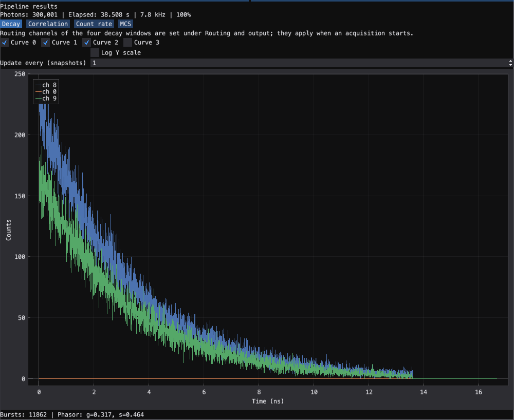
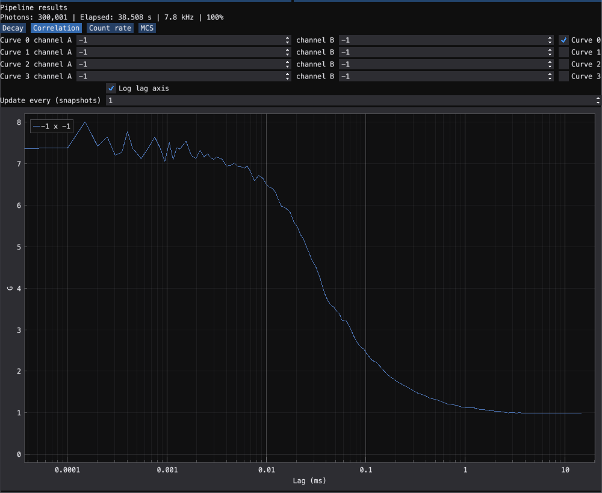
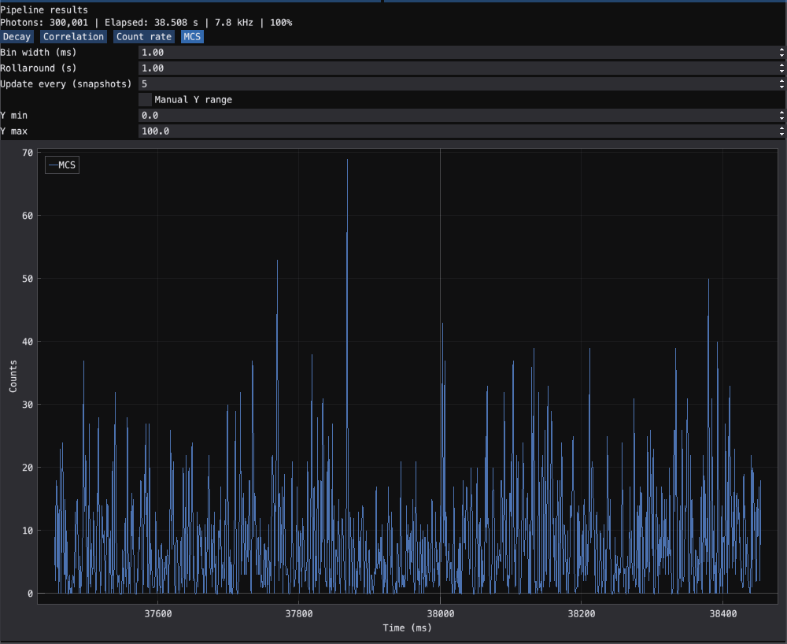

# Live acquisition: watching a measurement while it happens

**Tools → Views → Acquisition** streams photons from a TCSPC card — Becker &
Hickl SPC-130/150/160/180, PicoQuant, BrickMic — or from the built-in photon
simulator, and analyses them *while they arrive*: a decay per detector, an FCS
correlation, count rates, an MCS trace and inter-photon times, all updated per
chunk. Nothing here re-reads the photons it has already seen, so the display
costs the same at minute 30 as at minute 1 (see
{doc}`Streaming analysis </concepts/live_streaming_analysis>`).

Opening the plugin also starts a **demo stream** and opens an **Acquisition fit
window** next to the control window (see [The Acquisition fit window](#the-acquisition-fit-window)).

You do not need hardware to follow this guide: **Simulation** is a full confocal
photon simulator — diffusion through a focus, FRET states, anisotropy,
photophysics — and produces the same B&H records a card does.

## Running one

1. Open **Setup → Settings → Acquisition** and pick the **Active Device Type**.
   With *Simulation*, the simulator's scalar parameters (excitation mode,
   photon counts, seeds, geometry, micro time, performance) are listed below
   the device picker. Set **Acquisition → Mode** to *Pulsed* if you want to see
   a decay: the default is CW, whose micro times are all zero, so the decay
   window shows a single spike at 0 ns and the phasor reads (1, 0). Every change
   is stored at once, and the Acquisition tool starts from what is stored: its
   **Device type**, and its simulator.

   ```{figure} figures/65_acquisition_settings.png
   :name: fig-65-acquisition-settings
   :width: 70%

   Setup → Settings → Acquisition with the simulator selected and switched to
   pulsed excitation. The per-species table (molecules in the box M, diffusion
   coefficient D, brightness per detector), the kinetics and the decay
   lifetimes have no form here: they are part of the parameter JSON the
   Acquisition tool shows under **Advanced simulation parameters**.
   ```
2. In the acquisition window, set the **stop conditions**: **Time limit (s)** and
   **Photon limit**, or both. At least one must be non-zero — an acquisition with
   neither would never stop on its own. The photon condition is checked per
   chunk, so a run overshoots it by up to one chunk (**Chunk Size** in the
   settings page, 16384 photons by default).
3. The four **routing channels** are the detector numbers the card emits, and
   window *i* of the decay and count-rate displays is channel *i* of that list.
   They default to 8, 0, 9, 1; the simulator's green detectors are 8 and 9
   (parallel and perpendicular, B&H numbering), so with the defaults its photons
   land in windows 1 and 3. The four fields are in the window's *Routing and
   output* section.
4. Optionally set an **Output folder**. On devices that support it, raw vendor
   words are written there during the run; the simulator writes `mNNN.spc`
   files plus `simulation_config.json` and `simulation_info.txt`. The field is
   pre-filled with the standard output folder of Setup → Settings → Acquisition when
   one is set; empty means nothing is written.
5. For a card, press **Initialize device** first — nothing touches the hardware
   before that click; the simulator needs no initialisation. Then press
   **Start**. **Peak brightness** and **Deterministic seed** (section
   *Simulator configuration*) apply to the next simulated run: the brightness
   scales every species' brightness so that the largest is the value you set.

The line above the live plots reports the photon count, the elapsed time, the mean
count rate in kHz and the progress towards the photon limit.

## The Acquisition fit window

Opening the plugin simulates a 20 s two-species stream (a donor-dominated species
with a 3.4 ns donor lifetime and a high-FRET species with 1.1 ns, two detection
channels; `chisurf/plugins/core/acq/demo.py`, cached under `<settings>/demos/acq`),
registers it as a dataset and opens a fit window named **Acquisition**. Its model
has no parameters. Its pages are the live plots: **Decay**, **Correlation**,
**Count rate** (with the mean lines of the native window), **MCS** and **Macro time**;
they fill while the stream runs.

```{figure} figures/65_acquisition_fit_window.png
:name: fig-65-acquisition-fit-window
:width: 100%

The Acquisition fit window with the demo stream: decay of both detection
channels on a log axis. Each page's controls (decay curves, correlation channel
pairs, MCS bin width and range, macro-time plot type, update rate) are in the
main window's *Plot settings* dock while the page is current.
```

The count rate keeps its own tab in the acquisition window. A run started from the
acquisition window (simulator or card) feeds the same dataset, so the fit window
shows it too.

From Python, headless:

```python
from chisurf.plugins.core.acq.dataset import open_demo

dataset = open_demo()            # dataset + "Acquisition" fit, stream running
dataset.refresh()                # newest pipeline snapshot -> dataset.y, dataset.live.series
```

## What the plots show

The plots sit under *Pipeline results* in the acquisition window, one tab each;
the *Result visibility* boxes choose which tabs exist (Decay, Correlation and
Count rate by default, Macrotime and MCS on request).

**Fluorescence decays** — one micro-time histogram per routing channel,
identical to a `bincount` of the saved micro times. The x axis is nanoseconds
when the device states its TAC resolution, and TAC channels when it does not; it
is never a guess.



The line under the plot is two quality numbers that come free with the same
photon pass: the **burst count and rate** from a sliding-window burst search, and
the **phasor** (g, s) of all micro times. Both are diagnostics for alignment and
sample quality, not analyses — a phasor that drifts during a measurement is worth
knowing about before the measurement ends.

**Correlation curve** — up to four live FCS curves. Each is a channel pair
(*channel A*, *channel B* on the Correlation tab): the same channel twice is an autocorrelation, two
different channels a cross-correlation with the lag running from the first to the
second, and `-1` means *every* photon. The curve is the multi-tau correlator's,
computed incrementally and agreeing with the offline correlator on the same
photons.



**MCS trace** — the intensity trace at the configured bin width, showing the last
*Rollaround (s)* seconds. Only that window is kept, and it keeps its absolute
position on the time axis, so the trace scrolls rather than restarting.



**Count rate** — one point per chunk per channel plus their sum, in counts per
second, against macro time.

**Macrotime plot** — inter-photon times; a quick look at whether the stream is
Poissonian or structured.

## Saving

The live path analyses; it does not yet write a self-contained file. On devices
that drip raw vendor words, an **output folder** captures them and the run can be
re-analysed offline; without one, the photons reach the display and nowhere else,
and the status line says so when the run ends rather than implying a save. A
native `.pto` sink written *during* the measurement — clocks and channel map as
header tags, surviving a crash — is the tracked next step.

## Without a GUI

The pipeline is Qt-free and is the same object the GUI feeds. Push raw device
words at it and read display state back:

```python
import numpy as np
import tttrlib
from chisurf.plugins.core.acq.pipeline import AcquisitionPipeline, PipelineConfig

pipeline = AcquisitionPipeline(PipelineConfig(
    record_type=tttrlib.RECORD_SPC130,   # the device's record format
    macrotime_clock=50e-9,               # seconds per macro-time tick
    channels=(8, 0, 9, 1),               # routing channels, in window order
    correlation_pairs=((0, 8, 8), (1, 8, 0)),   # (curve, channel a, channel b)
    mcs_bin_width_ms=1.0,
    mcs_rollaround_ms=1000.0,
    photon_limit=1_000_000,
))

# uint32 records, as read from the FIFO; with no card, split the simulator's
# words (next block) into chunks: device_chunks = np.array_split(words, 10)
for chunk in device_chunks:
    pipeline.push(chunk)
    if pipeline.stop_reason:
        break

pipeline.flush()                         # the correlators emit their last bin
state = pipeline.snapshot()
tau_ms, g = pipeline.correlation(0)
decay = pipeline.decay(0)
```

`snapshot()` is plain data — histograms, curves, count rates, the burst count and
the phasor — and contains no photon arrays: everything in it is sized by the
configuration rather than by how long the acquisition ran.

To generate a stream to push, the simulator is one call:

```python
from chisurf.plugins.core.acq.tcspc_devices.simulation.core.algorithms import (
    generate_spc132_uint32,
)

words = generate_spc132_uint32({
    "N_ph_max": 50_000,
    "pulsed_exc": 1,
    "decay_lifetimes": [[1.0, 3.5]],     # amplitude, lifetime in ns
    "psf_type": "analytic_gaussian3d",
})
```

`psf_type` is one of `gaussian3d` (default), `analytic_gaussian3d` (the same
Gaussian evaluated on the fly, no voxel grid), `gaussian_lorentzian` (a confocal
detection volume whose waist expands with `psf_zR`) or `radial` (a measured
radially-symmetric focus, read from `psf_file`). The name selects the
constructor and nothing catches it: an unknown name, a `radial` without a
`psf_file`, or a photon library built without that grid all fail the call. None
of them falls back to the plain Gaussian, because a substituted focus changes
the answer without changing anything you can see.

## Using it well

- Check the phasor line before trusting the decay: (1, 0) means every micro
  time is zero — CW excitation, or a card whose TAC is not running.
- A photon stop condition overshoots by up to one chunk; for an exact count,
  cut the saved raw words afterwards.
- Set the output folder deliberately: a configured standard folder is prefilled, so
  a quick test run leaves `mNNN.spc` files there.

## Known behaviour

- The simulator's **background photons** (`q_bg`) carry micro-time 0, so a decay
  with background shows a spike in its first bin. The demo therefore has no
  background.

## The controls of each tab

The live plots are drawn from `AcquisitionPipeline.snapshot()`
(`chisurf/plugins/core/acq/gui/live_plots.py`, controls in `live_plots.view.json`):

- **Decay**: Curve 0–3 shown or hidden, Log Y scale, Update every (snapshots).
- **Correlation**: channel A / channel B per curve (`-1` = every photon), Log lag axis.
- **Count rate**: channel per curve, **Set to mean** (draws a line at the displayed
  mean), rolling window size, binning (points per bin), Log Y.
- **MCS**: Bin width (ms), Rollaround (s), Manual Y range.
- **Macrotime**: dt or absolute times.

Routing channels, correlation pairs, MCS bin width and rollaround are fixed when the
pipeline is built, so they apply from the next Start; everything else acts on the
running plot. All settings are saved with the plugin settings.

## Related

- {doc}`Streaming analysis </concepts/live_streaming_analysis>` — why the live
  path is incremental, and where it is exactly the batch answer
- {doc}`Simulating photon streams </guides/18_tttr_simulation>` — the simulator
  on its own, for generating test data
- {doc}`Handling TTTR files </guides/12_handling_tttr_files>` — reading what was
  saved
