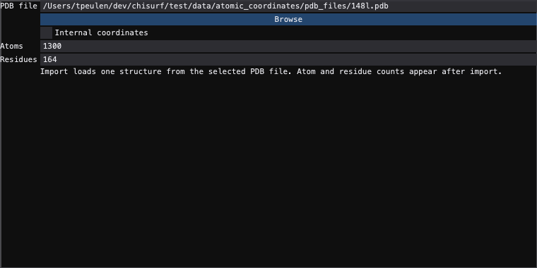

# Single-file structure reader

In the **Read data** dock choose **Experiment** `Modelling`, then type a PDB
filename into **PDB file** or use **Browse**. The reader imports one file.
**Internal coordinates** also computes the molecule's internal coordinates
(dihedral angles etc.).



Press **+ Data** to read the selected file. **Atoms** and **Residues** describe
the last structure read; selecting another file clears them until it is read.
The shipped 148L example has 1,300 atoms and 164 residues.

```python
from chisurf.core.experiments.modelling.reader import StructureReader

reader = StructureReader(filename="test/data/atomic_coordinates/pdb_files/148l.pdb",
                         compute_internal_coordinates=True,
                         record_provenance=False)
structures = reader.get_data()
```

Creating a reader, or restoring one from a project, records the source without
opening it. A saved project restores its embedded atoms when the original file
is no longer there; the counters show that structure only when its recorded
source is the selected one.
