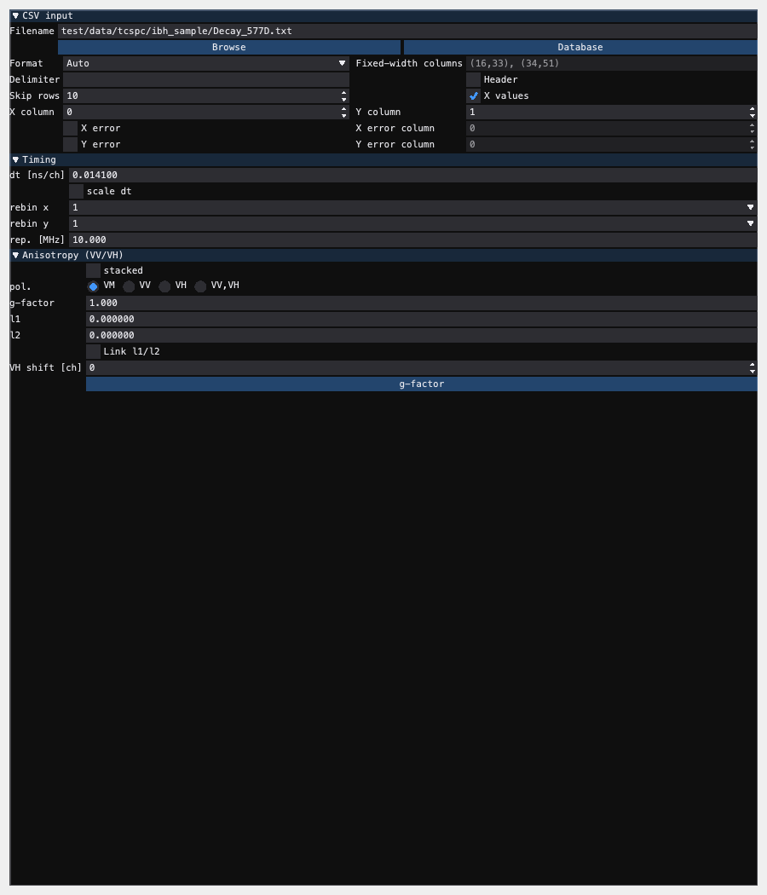

# TCSPC file readers

## TXT/CSV {#tcspc-txtcsv}

Select the **TCSPC** experiment and **TXT/CSV** reader. The native settings
form has **CSV input**, **Timing** and **Anisotropy (VV/VH)** groups. Settings
change the reader directly and are retained when a project is saved/reopened.

### Source and import

Type a filename, use **Browse**, or use **Database** to materialize a dataset
from MMFDB. **+ Data** imports the selected source with this reader's settings.
With an empty source, it opens the same native picker and imports once after
selection. The existing reader help remains available through **?**.



### Format, columns and errors

- **Auto** detects the existing text/vendor or serialized curve format.
- **CSV** reads delimited numeric text; an empty delimiter retains inference.
  An explicit delimiter is passed to the parser.
- **YAML** reads serialized DataCurve data. Auto also recognizes JSON.
- **FWF** reads fixed-width text using widths such as `5, 7`, or zero-based,
  stop-exclusive ranges such as `(3, 8), (10, 17)`. Ranges can skip padding.

**Skip rows** removes the preamble. **Header** follows the skipped preamble
for fixed-width files; delimited tables retain their established header
handling. Column numbers are zero-based: choose **X column** and **Y column**.
With **X values** off, the reader generates consecutive channel numbers.
With it on, the configured X column is read before time calibration.

Enable **X error** or **Y error** to read standard deviations from their
configured columns. X errors follow the time calibration. Independent Y
errors combine in quadrature during rebinning. With these flags off, the
reader retains zero X errors and its established counting-noise estimates.

### Timing and polarization

**dt** specifies nanoseconds per channel; **scale dt**, X/Y rebin and
repetition rate in MHz retain their existing meanings. Set these to match the
measurement before importing. For the shipped IBH sample, use 10 skipped
rows and 0.0141 ns per channel.

The anisotropy controls retain stacked mode, VM/VV/VH/VV-VH selection,
G-factor, leakage fractions l1/l2 and integer VH channel shift. Enabling
**Link l1/l2** copies l1 to l2 and keeps them equal on subsequent l1 edits.
**g-factor** opens the native calibration inspector; closing a completed
calculation applies finite G, rounded shift and available mixing estimates.
Closing the owning settings view cancels its child and prevents late updates.

### Workflow

1. Select TXT/CSV and choose the measurement source.
2. Check format, skipped/header rows and the X/Y/error columns.
3. Set timing and the measurement's polarization/calibration.
4. Press **+ Data** and inspect the imported decay before fitting.

For a headless read with the same settings:

```python
from chisurf.core.experiments.tcspc import TCSPCReader

reader = TCSPCReader(filename="test/data/tcspc/ibh_sample/Decay_577D.txt",
                     skiprows=10, dt=0.0141, record_provenance=False)
curves = reader.read()
```

The lower-level `read_tcspc_csv` API also supports explicit matrix column
sets. The form's working integer fields select the input columns directly.

---

## TTTR-file {#tcspc-tttr}

### Purpose

The **TTTR-file** reader converts time-tagged, time-resolved (TTTR) photon
streams into TCSPC decay histograms using `tttrlib`. It is implemented by
`chisurf.core.experiments.tcspc.TCSPCTTTRReader` and the
`TCSPCTTTRReaderControlWidget` controller.

Use this reader when you have photon-stream data from hardware that stores
individual photon arrival times (e.g. PicoQuant PTU/HT3 or Becker & Hickl SPC
TTTR formats) and want to build decays by integrating the micro-time axis.

When you select **Experiment → TCSPC** and **File type → TTTR-file**, the
"File parameters" group shows a compact TTTR panel:

- **Routine** (`reading_routine`)
  - Drop-down list of TTTR container types, e.g. `PTU`, `HT3`, `SPC132`,
    `SPC630`.
  - Passed as the second argument to `tttrlib.TTTR(filename, reading_routine)`.

- **Channels** (`channel_numbers`)
  - Comma-separated list of routing channel indices (e.g. `0, 3`).
  - The reader calls `tttr.get_tttr_by_channel(self.channel_numbers)` to
    restrict the TTTR stream to these channels before histogramming.

- **Binning** (`micro_time_coarsening`)
  - Discrete micro-time binning factor (`1`, `2`, `4`, `8`, `16`).
  - Used as the argument to
    `tttr_selected.get_microtime_histogram(self.micro_time_coarsening)`.

### Data generation

For each selected TTTR file, the reader:

1. Constructs a `tttrlib.TTTR` instance with the chosen routine.
2. Selects photons from the specified channels.
3. Computes a micro-time histogram with the configured coarsening factor.
4. Converts the micro-time axis from seconds to nanoseconds (`x *= 1e9`).
5. Trims trailing zero bins so the decay stops at the last non-zero count.
6. Creates a `chisurf.core.data.DataCurve` with:
   - `x`: micro-time in ns,
   - `y`: counts per bin,
   - `ey`: Poisson noise via `chisurf.core.fluorescence.tcspc.counting_noise(y)`,
   - `experiment`: the current TCSPC experiment,
   - `data_reader`: the `TCSPCTTTRReader` instance.

The curve name is derived from the filename and channel list, e.g.
`"file_ch(0,3)"`.

### Typical workflow

1. **Select experiment and reader**
   - In the *Read data* dock, choose **Experiment → TCSPC**.
   - In **File type**, choose **TTTR-file**.

2. **Configure TTTR parameters**
   - Set **Routine** to match the acquisition container (e.g. `PTU`, `HT3`).
   - Enter the routing **Channels** to include in the decay.
   - Choose a **Binning** factor for micro-time (trade-off between resolution
     and noise).

3. **Load data**
   - Click **Data** and select one or more TTTR files.
   - The reader builds decay histograms and adds them as datasets.

---

## Becker-SDT {#tcspc-sdt}

### Purpose

The **Becker-SDT** reader loads Becker & Hickl `.sdt` histogram files using
`chisurf.core.fio.fluorescence.sdtfile.SdtFile`. It is implemented by
`TCSPCSetupSDTWidget`, which wraps a `TcspcSDTWidget` for inspecting and
selecting curves.

Use this reader when you have TCSPC decays stored as Becker & Hickl SDT
histograms rather than raw TTTR streams or ASCII/CSV files.

### SDT widget behavior

`TcspcSDTWidget` performs the low-level SDT handling:

- **File** (`filename`)
  - The selected `.sdt` file, opened via `SdtFile(filename)`.
  - The widget populates a **Curve** combo box with indices `0..n_curves-1`.

- **Curve selection** (`curve_number`)
  - Chooses which internal SDT histogram to expose.
  - `ph_counts` returns the selected histogram as a NumPy array.

- **Time axis** (`times`)
  - Uses `self._sdt.times[0] * 1e9` to convert the hardware time base into
    **nanoseconds**.

- **Repetition rate** (`rep_rate`)
  - Computed from SDT `measure_info[curve]['rep_t']` as
    `1.0 / (rep_t * 1e-3)` → **MHz**.

- **Curve construction**
  - `curve` builds a `chisurf.core.data.DataCurve` with:
    - `x`: time in ns,
    - `y`: photon counts,
    - `ey`: Poisson noise via `chisurf.core.fluorescence.tcspc.counting_noise`,
    - `name`: `"<filename> _ <curve_number>"`.

`TCSPCSetupSDTWidget.read` iterates over all available curves in the file and
returns a list of `DataCurve` objects, making each curve available as a
separate dataset.

### Typical workflow

1. **Select experiment and reader**
   - In the *Read data* dock, choose **Experiment → TCSPC**.
   - In **File type**, choose **Becker-SDT**.

2. **Open SDT file**
   - Use the `...` button to select a `.sdt` file.
   - Inspect header/metadata in the text area if needed.

3. **Select curves**
   - Use the **Curve** combo box to preview individual histograms.
   - The reader will convert all curves into separate datasets when reading.

4. **Load data**
   - Click **Data** in the main GUI to import the SDT curves as TCSPC
     datasets.

---

## Simulator {#tcspc-simulator}

### Purpose

The **TCSPC Simulator** reader generates synthetic TCSPC decays based on a
user-defined lifetime spectrum. It is implemented by
`chisurf.core.experiments.tcspc.TCSPCSimulatorSetup` and configured via the
`TCSPCSimulatorSetupWidget`.

Use this when you want to test models, fitting routines, or instrument
response handling without loading real data.

### Simulator parameters

The simulator is configured via the **TCSPC simulator** panel
(`TCSPCSimulatorSetupWidget`, see `tcspc_simulator.ui`). It exposes the
following core parameters:

- **Name** (`sample_name`)
  - Logical name for the simulated dataset.

- **Lifetime spectrum** (`lifetime_spectrum`)
  - Comma-separated list of numeric values passed to
    `chisurf.core.fluorescence.general.calculate_fluorescence_decay`.
  - Interpreted as component lifetimes / amplitudes according to that
    function.

- **n TAC** (`n_tac`)
  - Number of time channels in the simulated decay (default `4096`).

- **Peak count** (`p0`)
  - Peak photon count scale (stored on the setup; the exact interpretation is
    delegated to the decay generation routine).

- **dt [ns]** (`dt`)
  - Time-per-channel in nanoseconds (default `0.0141`).

- **Instrument response function** (`instrument_response_function`)
  - Optional IRF widget/curve selected in the **Instrument response
    function** group box.
  - The GUI offers two options:
    - A **Select IRF** button that picks a dataset from the imported
      TCSPC curves.
    - A Gaussian fallback defined by *Gaussian IRF mean [ns]* and
      *sigma [ns]* when no dataset is selected.

Internally, `TCSPCSimulatorSetup.read` and the simulation preview
(`TCSPCSimulatorSetupWidget._simulate_decay`) perform the following steps:

1. Builds a time axis `x = arange(n_tac) * dt`.
2. Calls `calculate_fluorescence_decay(lifetime_spectrum=self.lifetime_spectrum,
   time_axis=x)` to obtain a model decay `y`.
3. Computes Poisson noise via `chisurf.core.fluorescence.tcspc.counting_noise(y)`.
4. Wraps the result in a `DataCurve` and returns a `DataCurveGroup`
   containing the single simulated dataset.

In the GUI, the simulator panel also offers a **Simulation preview**
section with:

- A **Simulate** button that runs the same decay computation (including
  optional IRF convolution and Poisson noise) and overlays the IRF on a
  log‑scaled preview plot.
- An **Add** button that takes the latest simulated trace and appends it
  to `chisurf.imported_datasets` as an `ExperimentDataCurveGroup`, so it
  behaves like any other TCSPC dataset in selectors and fits.
- A small `...` tool button next to the *lifetime spectrum* text field
  that can load a spectrum from a CSV/text file.

#### Lifetime spectrum examples

The lifetime spectrum is stored as an interleaved list of amplitudes and
lifetimes. For example, the default

```text
0.4, 1.1, 0.6, 4.1
```

corresponds to two components

- component 1: amplitude `0.4`, lifetime `1.1 ns`
- component 2: amplitude `0.6`, lifetime `4.1 ns`

You can either type this string directly into the *lifetime spectrum*
field or use the `...` loader button. The loader accepts:

- A **1‑column file** containing the interleaved values, e.g.

  ```text
  0.4
  1.1
  0.6
  4.1
  ```

- A **2‑column file** with amplitudes and lifetimes in separate
  columns, e.g.

  ```text
  # amp   tau [ns]
  0.4     1.1
  0.6     4.1
  ```

In the 2‑column case the widget automatically converts the table into
the interleaved representation and updates the text field. Any change to
the text field immediately updates `cs.current_setup.lifetime_spectrum`.

### Typical workflow

1. **Select experiment and reader**
   - In the *Read data* dock, choose **Experiment → TCSPC**.
   - In **File type**, choose **Simulator**.

2. **Configure decay parameters**
   - Set **Name**, **lifetime spectrum**, **n TAC**, **Peak count**, and
     **dt [ns]**.
   - Optionally select or configure an **Instrument response
     function**.

3. **Preview the simulated decay**
   - Click **Simulate** to compute and display the decay (yellow) and IRF
     (red) on the preview plot.

4. **Generate and store data**
   - Either click **Data** (reader‑style) or click **Add** in the
     Simulation preview. In both cases a synthetic TCSPC decay is created
     and added as a dataset, ready for fitting like any other TCSPC
     curve.
