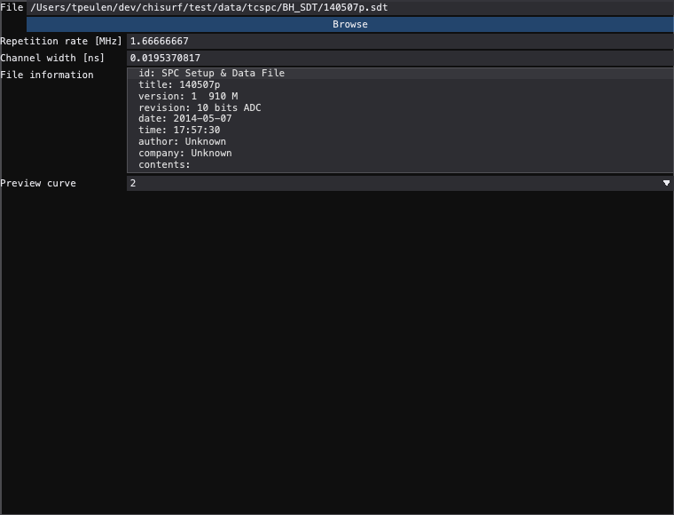
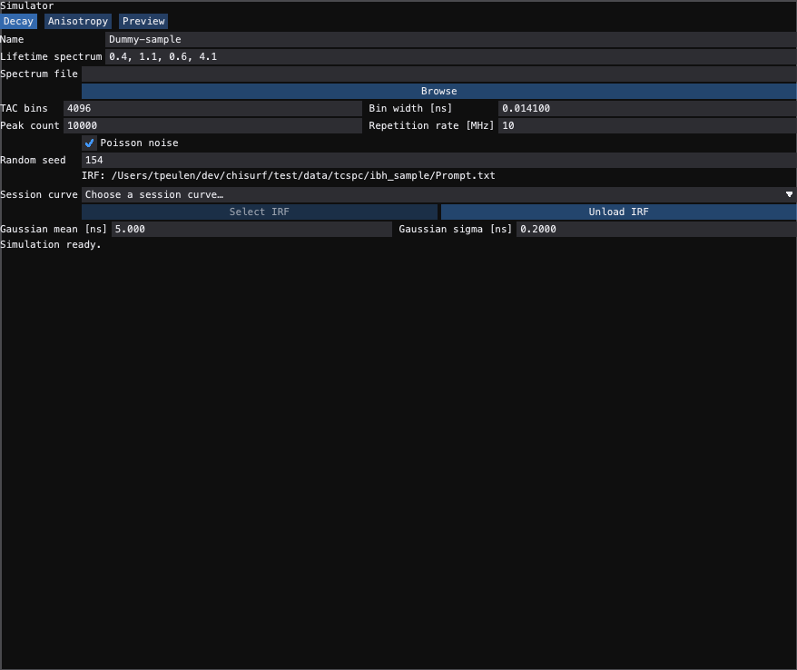

# TCSPC file readers

The **TCSPC** experiment has four readers, chosen as the **File type** in the
**Read data** dock. Each one's settings appear under *File parameters*; they
change the reader directly and are saved with a project.

## TXT/CSV {#tcspc-txtcsv}

The settings form has three groups: **CSV input**, **Timing** and
**Anisotropy (VV/VH)**.


### Source

Type a filename, use **Browse**, or use **Database** to take a dataset from
MMFDB. **+ Data** reads the selected source; with no source it opens the file
picker first.

### Format, columns and errors

| Format | Reads |
| --- | --- |
| **Auto** | detects text, vendor and serialized-curve files (YAML or JSON) |
| **CSV** | delimited numbers; an empty **Delimiter** is inferred, an explicit one is passed to the parser |
| **YAML** | a serialized `DataCurve` |
| **FWF** | fixed-width text; **Fixed-width columns** takes widths (`5, 7`) or zero-based, stop-exclusive ranges (`(3, 8), (10, 17)`), and ranges can skip padding |

**Skip rows** drops the preamble; for fixed-width files **Header** marks the
line after it as a header. Columns are zero-based (**X column**,
**Y column**). With **X values** off the x-axis is the channel number; with it
on, the X column is read and then calibrated.

**X error** and **Y error** read standard deviations from **X error column**
and **Y error column**. X errors are calibrated with the x-axis; Y errors add
in quadrature when rebinned. With both off, X errors are zero and Y errors are
the counting noise of the decay.

### Timing and polarization

**dt [ns/ch]** is the channel width, **rebin x** / **rebin y** bin the decay
(**scale dt** multiplies dt by the y-rebin factor; set automatically for
stacked VV/VH files), and **rep. [MHz]** is the repetition rate. For the shipped IBH sample
(`test/data/tcspc/ibh_sample/Decay_577D.txt`) use 10 skipped rows and
0.0141 ns per channel.

**stacked** reads a file holding VV and VH one after the other; **pol.**
selects VM, VV, VH or both (VV,VH). **g-factor**, the mixing fractions
**l1**/**l2** and the integer **VH shift [ch]** are applied to the anisotropy
pair; **Link l1/l2** keeps l2 equal to l1. The **g-factor** button opens the
G-factor calibration; closing it after a finished calculation applies the G
factor, the rounded shift and any mixing estimates it found.

### Workflow

1. Choose the source.
2. Check the format, the skipped and header rows and the columns.
3. Set the timing and the polarization.
4. Press **+ Data** and inspect the decay before fitting.

Headless, with the same settings:

```python
from chisurf.core.experiments.tcspc import TCSPCReader

reader = TCSPCReader(filename="test/data/tcspc/ibh_sample/Decay_577D.txt",
                     skiprows=10, dt=0.0141, record_provenance=False)
curves = reader.read()
```

The lower-level `read_tcspc_csv` also takes explicit sets of matrix columns.

---

## TTTR-file {#tcspc-tttr}

Builds a decay from a time-tagged photon stream (PicoQuant PTU/HT3, Becker &
Hickl SPC, …) with `tttrlib`, by histogramming the micro-times. Implemented by
`chisurf.core.experiments.tcspc.TCSPCTTTRReader`.

### Settings

- **Detector** — **Setup** and **Detector** pick a named detector of a saved
  detector setup, which sets the routing channels, the micro-time window and
  the setup's LUTs; or set **Routine** (the TTTR container type, e.g. `PTU`,
  `HT3`, `SPC-130`) and **Routing chs** by hand.
- **Acquisition** — **coarsen**, the micro-time binning factor (neighbouring
  bins are summed), and **shift [bins]**, an integer shift of the histogram.
- **Anisotropy (VV/VH)** — **VH chs**, **pol.**, **g-factor** and
  **VH shift [bins]**. With **VH chs** empty the routing channels give one
  decay and the other three are not used. With **VH chs** set, the routing
  channels are the parallel (VV) detectors and **pol.** selects the output:
  **VV** or **VH** alone, **VV,VH** as two stacked curves (the structure an
  anisotropy fit takes by position, with the g-factor attached), or **VM** =
  VV + 2 g VH with errors $\sqrt{VV + 4g^2 VH}$. **VH shift [bins]** moves the
  VH histogram before any of these.

### What a read does

1. Opens the file as `tttrlib.TTTR` with the routine.
2. Keeps the photons of the routing channels (and, when set, of the VH
   channels as a second group).
3. Histograms their micro-times with the coarsening factor and applies the
   shift; then the VH shift and the polarization above.
4. Converts the micro-time axis to ns and drops the trailing empty bins.
5. Returns a `DataCurve` per output with counts per bin, Poisson errors
   (`chisurf.core.fluorescence.tcspc.counting_noise`) and the file header in
   its metadata, named `<file>_ch(<channels>)`, e.g. `sample_ch(0,3)`; a
   polarized output appends ` VV`, ` VH` or ` VM`.

---

## Becker-SDT {#tcspc-sdt}

Reads a Becker & Hickl `.sdt` file (see {doc}`becker_hickl_files`). Choose the
file under **File**; **File information** shows its identification, title,
version, revision, date, time, author, company and contents.



**Repetition rate [MHz]** and **Channel width [ns]** are read-only, taken from
the measurement descriptor of the curve chosen in **Preview curve**; for an
excitation period $T$ in ns the rate is $1000/T$ MHz. **+ Data** reads *every*
curve of the file in order, each with its own time axis — the preview does not
filter. The shipped `test/data/tcspc/BH_SDT/140507p.sdt` holds three 1024-bin
curves with 0.019537 ns channels and a 600 ns excitation period (1.667 MHz).

```python
from chisurf.core.experiments.tcspc.sdt_reader import SDTReader

reader = SDTReader(filename="test/data/tcspc/BH_SDT/140507p.sdt",
                   curve_nbr=2, record_provenance=False)
curves = reader.read()  # all three curves
```

A project stores the source without opening it, so it reopens without the
original file; reading or previewing needs the file.

---

## Simulator {#tcspc-simulator}

Simulates decays instead of reading them. The form has three tabs —
**Decay**, **Anisotropy** and **Preview** — and opens with the sample name
`Dummy-sample`, the lifetime spectrum `0.4, 1.1, 0.6, 4.1` and the rotation
spectrum `0.2, 1`.



### Decay

**Name**, **Lifetime spectrum** (interleaved amplitude, lifetime), **TAC bins**,
**Peak count**, **Bin width [ns]** and **Repetition rate [MHz]**. A
**Spectrum file** holds the spectrum as one interleaved column or as amplitude
and lifetime columns. An invalid entry keeps the previous values.

The IRF is a measured curve of the session (**Session curve**, then
**Select IRF**), or, after **Unload IRF**, a Gaussian of **Gaussian mean [ns]**
and **Gaussian sigma [ns]**. **Poisson noise** adds counting noise; an empty
**Random seed** samples unseeded, an integer makes the noise repeatable.

### Anisotropy

**Mode** VM or VV/VH, the rotation spectrum **Rotation b, rho [ns]**
(interleaved amplitude, correlation time), **g** and the mixing fractions
**l1**/**l2**.

### Preview and Add

**Simulate** shows the reader's output on log counts — one decay for VM, both
channels for VV/VH, with the scaled IRF overlaid for display only. **Add**
adds exactly that simulation (the same noise realization) to the session
without simulating again; **+ Data** in the Read data dock simulates afresh.

```python
from chisurf.core.experiments.tcspc.simulator import TCSPCSimulatorSetup

reader = TCSPCSimulatorSetup(lifetime_spectrum=[0.4, 1.1, 0.6, 4.1],
                             rotation_spectrum=[0.2, 1],
                             polarization="vv/vh", seed=154,
                             record_provenance=False)
curves = reader.read()  # VV and VH
```

The Python defaults differ from the form's presets: empty spectra, the name
`TCSPC-Dummy`, unseeded noise, 4096 bins of 0.0141 ns, a peak of 10 000 counts,
10 MHz and a Gaussian IRF at 5 ns with σ = 0.2 ns. Pass the spectrum you want.
