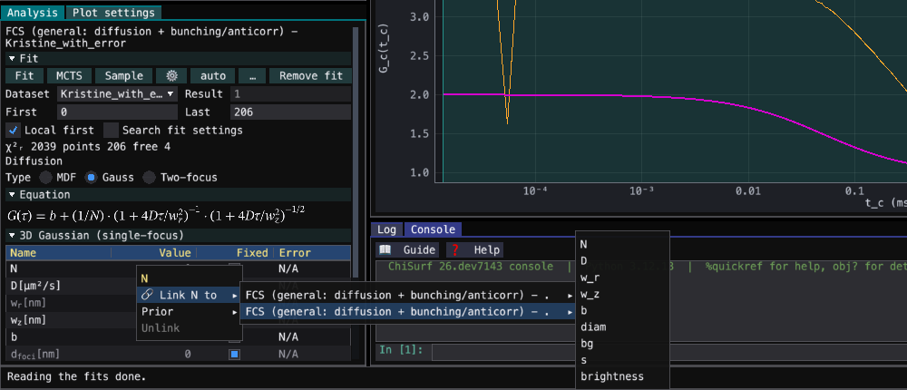

# Linking parameters

Linking makes one parameter *follow* another: the follower stops being a degree
of freedom and reads its value from the master. It is how a global analysis
shares one quantity across datasets — one lifetime, one correction factor, one
distance — and how a plugin's constant (an ndX calibration, for example) is tied
to the fits that should obey it.

A linked parameter disappears from the optimiser's free set but keeps its place
in the model, so the fit still reads its value. Refining the master updates every
follower.

## From the GUI

Right-click a parameter in the parameter table of the **Analysis** dock and open **🔗 Link \<name\> to**.



The menu lists the session's fits, and under each fit its parameters:

* **One entry per fit.** A fit group holding several curves lists its member
  curves first, because each curve carries its own parameters.
* **Only the parameters of the fit's equation** are offered, not every port of
  the model catalogue.
* Every parameter is a target except the one being linked, including a parameter
  of the *same name* in another fit. Linking `N` of one curve to `N` of
  another is the ordinary global-analysis case, and the menu addresses the target
  by identity, not by name.

**Unlink** in the same context menu makes the parameter free again; it is enabled
only while the parameter is linked. **Prior** beside it sets the parameter's
prior. Linking works on parameters that belong to no fit — an ndX calibration
constant, a plugin's working model — because each target is addressed by its
UUID rather than by a name and a fit.

## Reading a parameter table

A table says at a glance which numbers the fit will move:

| Appearance | Meaning |
|------------|---------|
| normal | free — the fit varies it |
| dimmed | **fixed**, an output, or linked: the fit will not move this number, and the cell cannot be edited |
| drawn in the link colour | **linked follower** — its value comes from its master |

Hovering a follower's value names its master.

Recursive links are refused — a parameter cannot follow itself, directly or
around a cycle.

## From a script

At the object level, assign the master to the follower's `link`:

```python
import chisurf

donor, fret = chisurf.fits[0], chisurf.fits[1]
donor.model.parameters_all_dict["tau1"].link = fret.model.parameters_all_dict["tau1"]
```

Through the action layer, which records the operation in the
[history](../development/history_project_mcp.md) projection:

```python
chisurf.core.actions.dispatch(
    name="parameter.link",
    payload={
        "source_fit_index": 0,
        "source_parameter": "tau1",
        "target_fit_index": 1,
        "target_parameter": "tau1",
    },
)
```

Over the [JSON-RPC server](../development/architecture_client_server.md)
(`python -m chisurf.server`), `parameter.link` accepts the
same addressing plus `parameter_uid` / `target_parameter_uid`, which is what lets
a parameter outside any fit — a plugin's working model — join the same link graph:

```python
client.call("parameter.link", {
    "parameter_name": "gamma",
    "target_parameter_uid": calibration_gamma_uid,
})
```

`parameter.unlink` (or `p.link = None`) reverses it.

## See also

* [FRET calibration](../guides/fret_calibration.md) — sharing one calibration
  across datasets.
* [Global View](plugins/globalview.md) — the link graph as a network, where links
  can also be made and removed.

## Saving a single parameter

For one finite, unlinked scalar, `Parameter.save(..., file_type="json")` (or
`"yaml"`, the default) writes its name, value, bounds, fixed state, description,
prior and JSON-compatible metadata. Loading restores the value and refreshes an
attached editor. Infinite bounds are written as `null`; bounds are kept even
while their enforcement is off.

```python
from chisurf.core.parameter import Parameter

scalar = Parameter(name="scale", value=2.0)
scalar.save("scale.json", file_type="json")
restored = Parameter(value=8.0)
restored.load("scale.json", file_type="json")
assert restored.value == 2.0
```

A linked parameter, or one whose value is a Python callable, is saved only with
its session or project; a standalone file refuses it. An old file that holds only
the parameter's repr has lost the value and raises an error on loading. After
changing a model value directly, `parameter.update()` refreshes an attached
editor.
